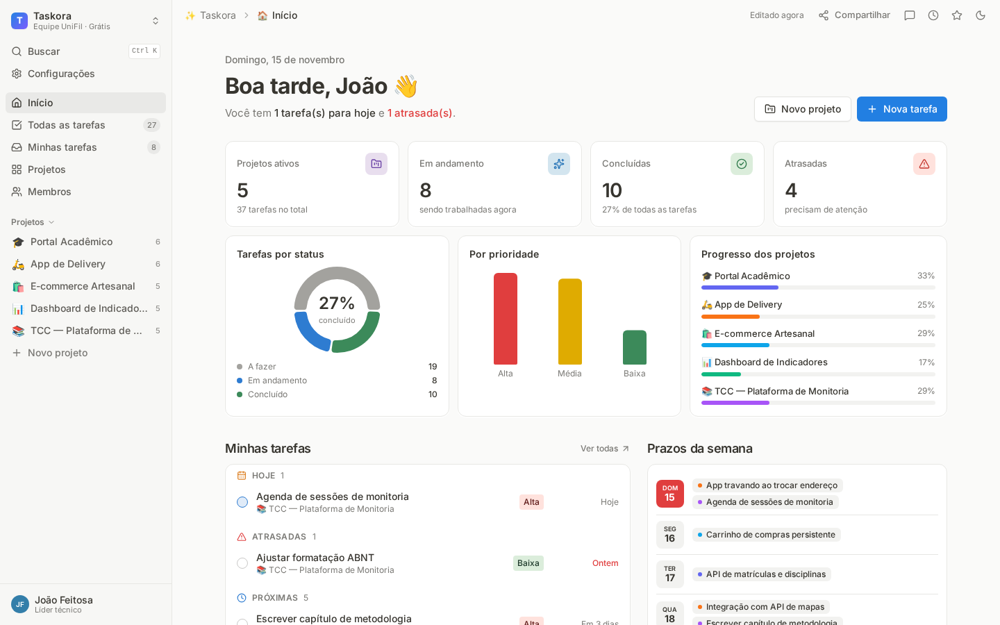
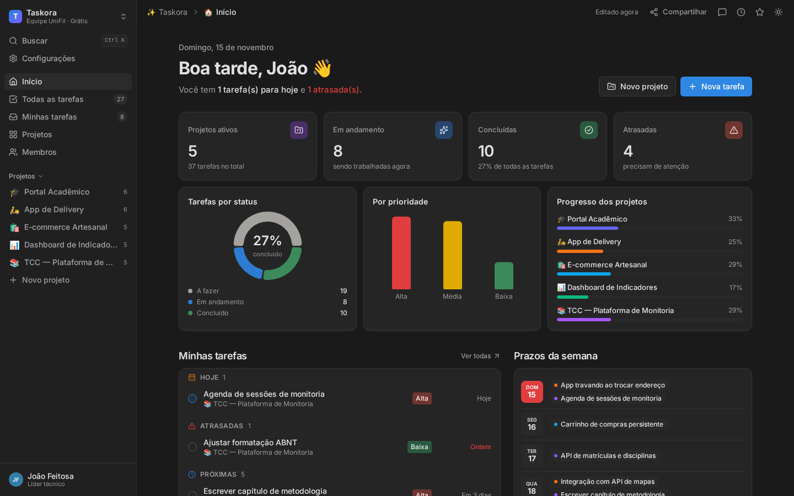
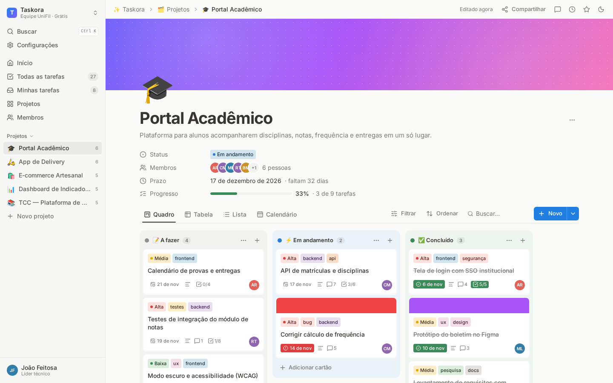
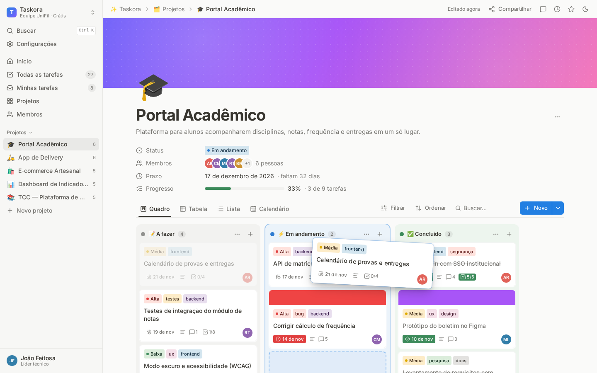
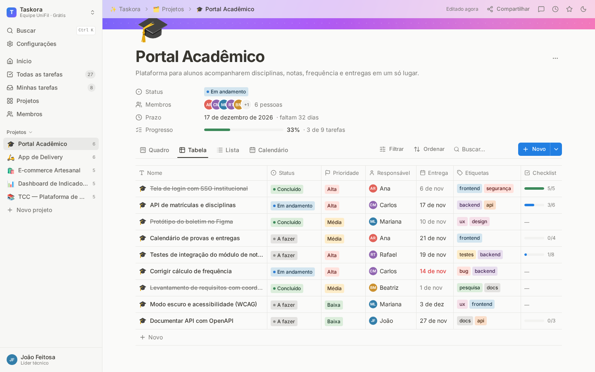
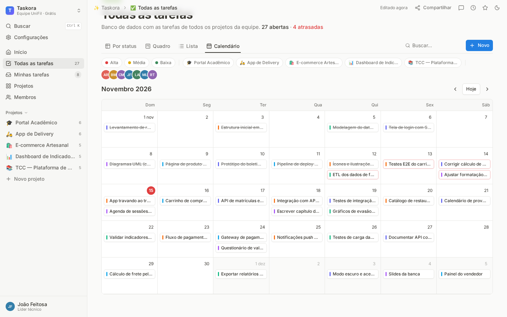
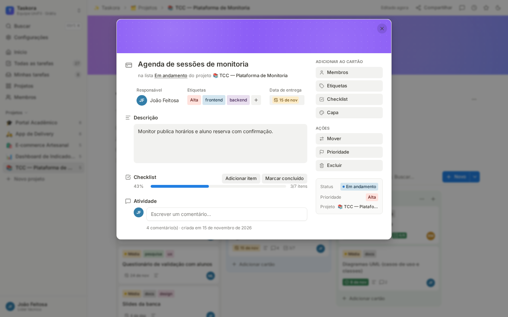
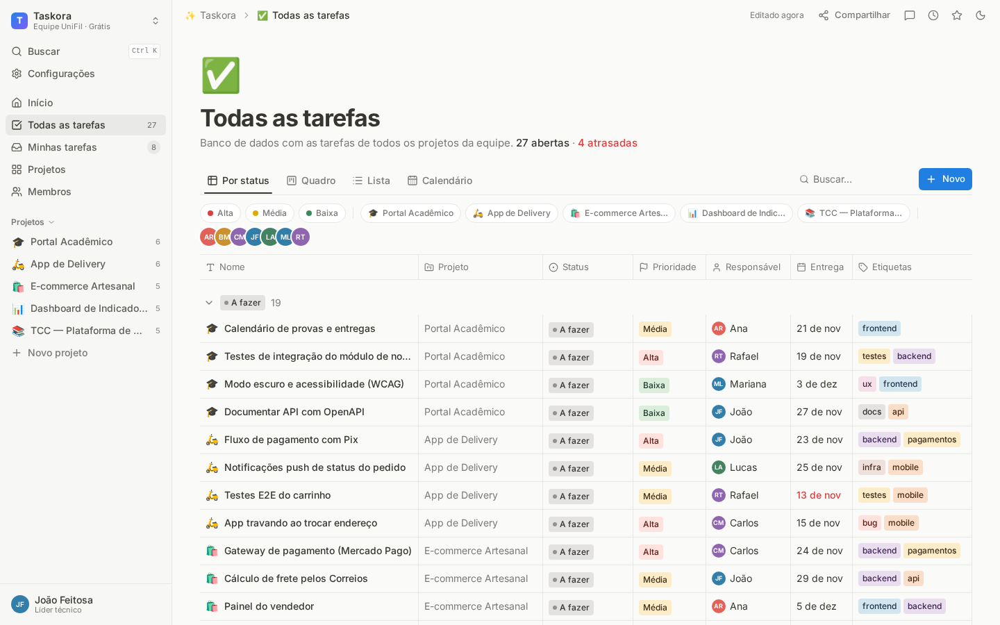
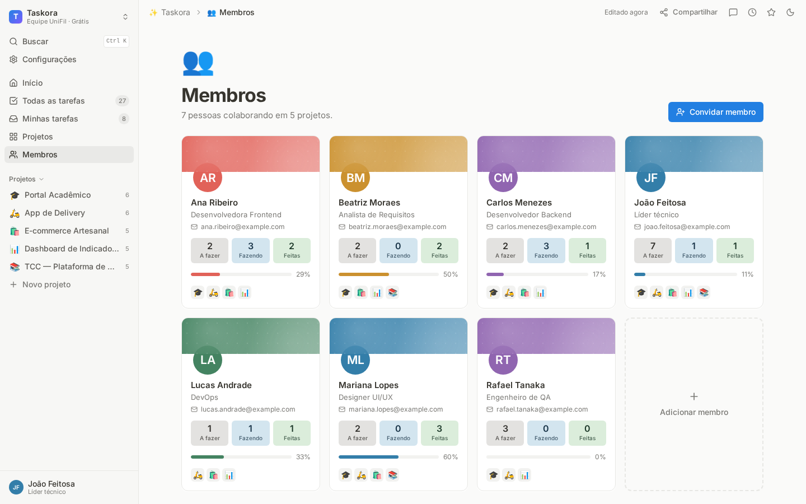
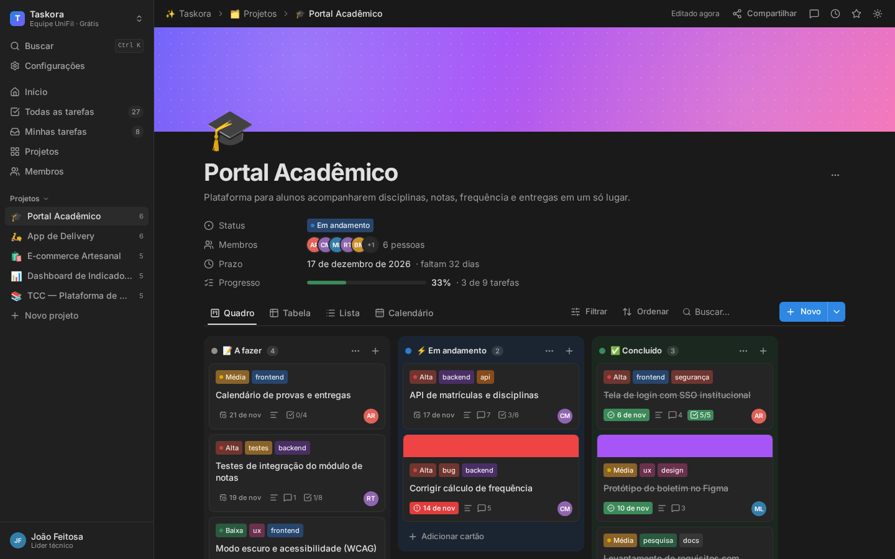

# Taskora — Controle de Tarefas e Projetos

[](https://joaogpnfs.github.io/tarefas-gestor/)
[](https://nodejs.org/)
[](LICENSE)

Sistema web para gerenciamento de tarefas e projetos com interface inspirada no Notion e no Trello, desenvolvido como projeto da disciplina Projeto e Desenvolvimento de Sistemas I do curso de Engenharia de Software da UniFil.



## 📋 Sobre o Projeto

O Taskora é uma aplicação web inspirada no Notion (barra lateral, páginas com capa e ícone, banco de dados em tabela) e no Trello (quadro Kanban com cartões, etiquetas e arrastar e soltar), que permite o gerenciamento visual de projetos e suas tarefas através de quadros Kanban. O sistema oferece CRUD completo para projetos, tarefas e membros da equipe, além de dashboard com estatísticas e identificação de tarefas atrasadas.

**Desenvolvido por:** João Gabriel Pereira Nascimento Feitosa da Silva  
**RA:** 263466036  
**Instituição:** Universidade Filadélfia (UniFil)  
**Ano:** 2026

## ✨ Funcionalidades

### Projetos (páginas no estilo Notion)
- ✅ Criar, listar, editar e excluir projetos
- 🖼️ Capa em degradê, ícone em emoji, título e descrição editáveis direto na página
- 🧾 Linha de propriedades: status, membros, prazo e progresso
- 🗂️ Quatro visualizações das tarefas: **Quadro**, **Tabela**, **Lista** e **Calendário**
- 🖼️ Galeria de projetos com capa, progresso e participantes

### Tarefas (cartões no estilo Trello)
- ✅ CRUD completo de tarefas
- 📋 Quadro Kanban com três listas (A fazer, Em andamento, Concluído) e arrastar e soltar
- 🏷️ Etiquetas coloridas, prioridades (Baixa, Média, Alta) e capa colorida no cartão
- ☑️ Progresso de checklist e contador de comentários
- 📅 Data de entrega com destaque: vermelho quando atrasada, verde quando concluída
- 🪟 Janela de detalhes do cartão com ações (Mover, Prioridade, Capa, Excluir)
- 🔍 Filtros por prioridade, projeto e responsável, além de busca rápida (Ctrl + K)

### Membros
- ✅ Gerenciamento de membros da equipe (galeria com avatar, cargo e contagem de tarefas)
- ✉️ Validação de email com verificação de duplicidade

### Início (dashboard)
- 👋 Saudação com a data do dia
- 📊 Cartões de estatísticas, gráfico de status (rosca) e de prioridades (barras)
- 📥 Minhas tarefas agrupadas em Hoje, Atrasadas e Próximas
- 🗓️ Prazos dos próximos 7 dias e projetos recentes

### Interface
- 🌗 Modo claro e escuro (preferência salva no navegador)
- 🔤 Tipografia Inter, paleta neutra e quente, sombras suaves e microanimações
- ♿ Respeita `prefers-reduced-motion`
- ⚡ Feedback visual com mensagens toast

## 🖼️ Capturas de Tela

| Início (claro) | Início (escuro) |
| --- | --- |
|  |  |

| Quadro Kanban do projeto | Arrastando um cartão |
| --- | --- |
|  |  |

| Visualização em tabela | Calendário |
| --- | --- |
|  |  |

| Detalhes do cartão | Todas as tarefas |
| --- | --- |
|  |  |

| Membros | Quadro (escuro) |
| --- | --- |
|  |  |

## 🚀 Como Executar

### Pré-requisitos

- Node.js 18 ou superior
- npm (gerenciador de pacotes do Node.js)

### Instalação

1. Clone o repositório:
```bash
git clone https://github.com/joaogpnfs/tarefas-gestor.git
cd tarefas-gestor
```

2. Instale as dependências do backend:
```bash
npm install
```

3. Instale as dependências do frontend:
```bash
cd web
npm install
cd ..
```

4. (Opcional) Popule o banco com dados de exemplo:
```bash
npm run seed
```

5. Build do frontend e backend:
```bash
npm run build
cd web && npm run build && cd ..
```

6. Inicie o servidor de produção:
```bash
npm start
```

O servidor irá servir tanto a API quanto o frontend React compilado.

7. Acesse no navegador:
```
http://localhost:4321
```

### Desenvolvimento

Para rodar em modo de desenvolvimento com hot-reload:

```bash
# Terminal 1: Backend com tsx
npm run dev

# Terminal 2: Frontend com Vite
cd web
npm run dev
```

No modo desenvolvimento, o frontend roda em `http://localhost:5173` e faz proxy das requisições `/api` para o backend em `http://localhost:4321`.

## 🧪 Como Executar os Testes

Execute os testes automatizados da API:

```bash
npm test
```

Os testes cobrem:
- ✅ Todas as operações CRUD
- ✅ Validações de dados
- ✅ Regras de negócio
- ✅ Filtros e consultas especializadas
- ✅ Estatísticas e agregações

## 📁 Estrutura do Projeto

```
tarefas-gestor/
├── src/                         # Backend (Express + TypeScript)
│   ├── database/
│   │   ├── schema.ts            # Schema SQLite + migração de colunas opcionais
│   │   └── connection.ts        # Gerenciamento de conexão
│   ├── models/                  # Projeto.ts, Tarefa.ts, Membro.ts
│   ├── routes/                  # projetos.ts, tarefas.ts, membros.ts, dashboard.ts
│   ├── types/index.ts           # Tipos compartilhados
│   ├── server.ts                # Servidor Express (API + frontend compilado)
│   └── seed.ts                  # Dados de exemplo (datas relativas a hoje)
├── dist/                        # Backend compilado (npm run build)
├── web/                         # Frontend (React + Vite + TypeScript)
│   └── src/
│       ├── components/
│       │   ├── Layout.tsx       # Estrutura: barra lateral + topo + modais globais
│       │   ├── Sidebar.tsx      # Barra lateral no estilo Notion
│       │   ├── Topbar.tsx       # Trilha de navegação (breadcrumbs) e tema
│       │   ├── TaskCard.tsx     # Cartão do quadro no estilo Trello
│       │   ├── TaskModal.tsx    # Detalhes/criação de cartão
│       │   ├── ProjectDialog.tsx, SearchDialog.tsx, ProjectGallery.tsx
│       │   ├── Avatar.tsx, Pills.tsx
│       │   ├── views/           # BoardView, TableView, ListView, CalendarView
│       │   └── ui/              # Componentes base (shadcn/ui + Radix)
│       ├── lib/                 # api.ts, data.tsx (estado global), ui.ts, theme.ts
│       └── pages/               # Home, ProjetoPage, Projetos, Tarefas, Membros
├── test/
│   └── api.test.ts              # Testes de integração da API
├── docs/
│   ├── index.html               # Landing page (GitHub Pages)
│   └── screenshots/             # Capturas de tela usadas neste README
├── documentacao/                # Documentação técnica, PDF e roteiro do vídeo
├── package.json
└── README.md
```

## 🛠️ Tecnologias Utilizadas

### Backend
- **Node.js 18+** - Ambiente de execução JavaScript
- **TypeScript 7.0** - Superset tipado do JavaScript
- **Express 5.3** - Framework web para APIs REST
- **better-sqlite3 13.2** - Driver SQLite síncrono para Node.js
- **CORS** - Middleware para compartilhamento de recursos

### Frontend
- **React 19** - Biblioteca para interfaces de usuário
- **Vite 8** - Build tool e dev server ultrarrápido
- **TypeScript 7.0** - Tipagem estática para JavaScript
- **Tailwind CSS 3.4** - Framework CSS utility-first
- **shadcn/ui** - Componentes acessíveis com Radix UI (Dialog, Dropdown Menu)
- **date-fns** - Datas em português (calendário, prazos relativos)
- **Inter (@fontsource-variable/inter)** - Tipografia
- **tailwindcss-animate** - Animações de entrada dos componentes
- **Lucide React** - Ícones modernos
- **Recharts** - Gráficos e visualizações de dados
- **@dnd-kit** - Drag-and-drop para Kanban board
- **Sonner** - Toast notifications elegantes
- **React Router 7** - Roteamento declarativo

### Testes
- **Mocha 12.0** - Framework de testes
- **Chai 6.3** - Biblioteca de asserções BDD/TDD
- **Supertest 7.3** - Testes de integração HTTP
- **tsx** - Execução de TypeScript com hot-reload

### Banco de Dados
- **SQLite** - Banco de dados relacional embarcado e serverless

## 📡 Endpoints da API

### Projetos
- `GET /api/projetos` - Listar todos os projetos
- `GET /api/projetos/:id` - Buscar projeto por ID
- `POST /api/projetos` - Criar novo projeto
- `PUT /api/projetos/:id` - Atualizar projeto
- `DELETE /api/projetos/:id` - Deletar projeto

### Tarefas
- `GET /api/tarefas` - Listar todas as tarefas
- `GET /api/tarefas/:id` - Buscar tarefa por ID
- `GET /api/tarefas?projeto_id={id}` - Filtrar tarefas por projeto
- `GET /api/tarefas/atrasadas/lista` - Listar tarefas atrasadas
- `POST /api/tarefas` - Criar nova tarefa
- `PUT /api/tarefas/:id` - Atualizar tarefa
- `DELETE /api/tarefas/:id` - Deletar tarefa

### Membros
- `GET /api/membros` - Listar todos os membros
- `GET /api/membros/:id` - Buscar membro por ID
- `POST /api/membros` - Criar novo membro
- `PUT /api/membros/:id` - Atualizar membro
- `DELETE /api/membros/:id` - Deletar membro

### Dashboard
- `GET /api/dashboard` - Obter estatísticas gerais

### Campos opcionais

Todos têm valor padrão, então clientes antigos continuam funcionando:

- **Projeto:** `emoji` (padrão `📁`), `capa` (nome do degradê, ex.: `aurora`) e `prazo` (data)
- **Tarefa:** `etiquetas` (texto separado por vírgulas ou array), `capa` (cor), `checklist_total`, `checklist_feitos` e `comentarios`

## 📚 Documentação

A documentação técnica completa do projeto está disponível em:
- [Documentação Técnica](documentacao/documentacao.md)
- [Roteiro para Vídeo](documentacao/roteiro-video.md)

A documentação inclui:
- Requisitos funcionais e não funcionais
- Casos de uso
- Diagrama de classes
- Modelo Entidade-Relacionamento
- Arquitetura do sistema
- Análise de riscos (FMEA)
- Plano de testes

## 🎯 Scripts Disponíveis

```bash
# Iniciar o servidor
npm start

# Compilar o backend
npm run build

# Executar testes
npm test

# Popular banco com dados de exemplo
npm run seed
```

## 🌐 Links

- **Repositório GitHub:** https://github.com/joaogpnfs/tarefas-gestor
- **GitHub Pages:** https://joaogpnfs.github.io/tarefas-gestor/

## 📝 Licença

Este projeto foi desenvolvido para fins acadêmicos como parte da disciplina Projeto e Desenvolvimento de Sistemas I.

---

**Universidade Filadélfia (UniFil)** | Engenharia de Software | 2026
