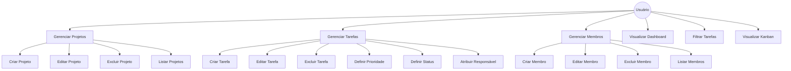
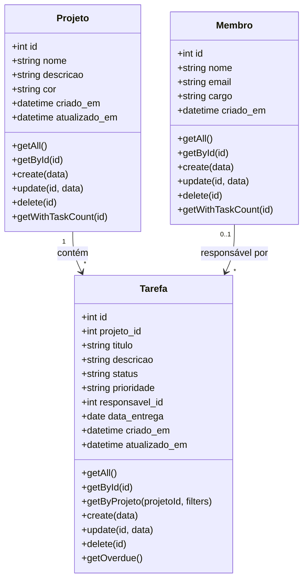
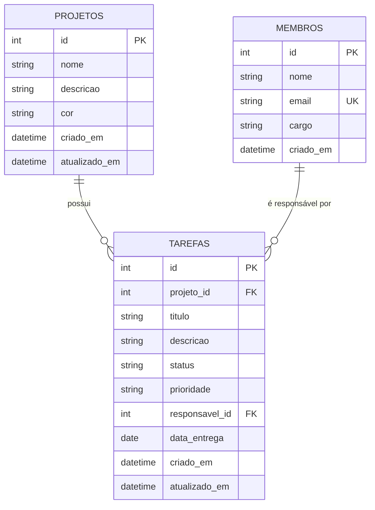

# Sistema de Controle de Tarefas e Projetos

---

**UNIVERSIDADE FILADÉLFIA – UNIFIL**

**Curso:** Engenharia de Software

**Disciplina:** Projeto e Desenvolvimento de Sistemas I

**Aluno:** João Gabriel Pereira Nascimento Feitosa da Silva

**RA:** 263466036

**Londrina – 2026**

---

## Sumário

1. [Introdução](#introdução)
2. [Objetivos](#objetivos)
3. [Justificativa](#justificativa)
4. [Escopo](#escopo)
5. [Requisitos](#requisitos)
   - 5.1. [Requisitos Funcionais](#requisitos-funcionais)
   - 5.2. [Requisitos Não Funcionais](#requisitos-não-funcionais)
6. [Regras de Negócio](#regras-de-negócio)
7. [Casos de Uso](#casos-de-uso)
8. [Diagrama de Classes](#diagrama-de-classes)
9. [Modelo Entidade-Relacionamento](#modelo-entidade-relacionamento)
10. [Arquitetura](#arquitetura)
11. [Tecnologias Utilizadas](#tecnologias-utilizadas)
12. [Protótipo e Telas](#protótipo-e-telas)
13. [Plano de Testes](#plano-de-testes)
14. [Análise de Falhas e Riscos (FMEA)](#análise-de-falhas-e-riscos-fmea)
15. [Cronograma](#cronograma)
16. [Conclusão](#conclusão)
17. [Referências](#referências)

---

## 1. Introdução

Este documento apresenta o projeto "Sistema de Controle de Tarefas e Projetos", uma aplicação web desenvolvida como trabalho prático da disciplina Projeto e Desenvolvimento de Sistemas I do curso de Engenharia de Software da Universidade Filadélfia (UniFil).

O sistema propõe uma solução para gerenciamento de projetos e tarefas, inspirado em ferramentas como Trello, permitindo o controle de atividades através de quadros Kanban, facilitando a visualização do progresso e a colaboração entre equipes.

---

## 2. Objetivos

### Objetivo Geral

Desenvolver um sistema web para controle e gerenciamento de tarefas e projetos, possibilitando o acompanhamento visual do progresso das atividades através de um quadro Kanban.

### Objetivos Específicos

- Implementar operações CRUD completas para projetos, tarefas e membros da equipe
- Desenvolver interface visual intuitiva com quadro Kanban para organização de tarefas
- Implementar sistema de filtros por prioridade, responsável e status
- Criar dashboard com estatísticas e métricas do sistema
- Desenvolver API REST para comunicação entre frontend e backend
- Implementar validações de dados e mensagens de erro amigáveis
- Garantir responsividade para acesso em dispositivos móveis

---

## 3. Justificativa

A gestão eficiente de projetos é fundamental para o sucesso de equipes de desenvolvimento de software. Ferramentas que facilitam a visualização do fluxo de trabalho, como quadros Kanban, melhoram significativamente a produtividade e a comunicação.

Este projeto justifica-se pela necessidade de compreender na prática os conceitos de desenvolvimento de sistemas web, incluindo arquitetura de software, padrões de projeto, persistência de dados e interfaces de usuário, aplicados em um contexto real de gestão de projetos.

A escolha por um sistema de controle de tarefas permite explorar diversos conceitos importantes:
- Modelagem de dados com relacionamentos entre entidades
- Implementação de API RESTful
- Manipulação de estado e interações complexas no frontend
- Validação de dados em múltiplas camadas
- Tratamento de erros e feedback ao usuário

---

## 4. Escopo

### Dentro do Escopo

- Cadastro, listagem, edição e exclusão de projetos
- Cadastro, listagem, edição e exclusão de tarefas
- Cadastro, listagem, edição e exclusão de membros da equipe
- Visualização de tarefas em quadro Kanban organizado por status
- Filtros de tarefas por prioridade, responsável e status
- Dashboard com estatísticas gerais e tarefas atrasadas
- Interface web responsiva
- API REST para todas as operações
- Persistência de dados em banco SQLite
- Testes automatizados da API

### Fora do Escopo

- Sistema de autenticação e autorização de usuários
- Funcionalidade de drag-and-drop no Kanban
- Notificações por email ou push
- Comentários e anexos em tarefas
- Histórico de alterações
- Integração com ferramentas externas
- Aplicativo mobile nativo
- Deploy em ambiente de produção

---

## 5. Requisitos

### 5.1. Requisitos Funcionais

| ID | Descrição | Prioridade |
|----|-----------|------------|
| RF01 | O sistema deve permitir criar, listar, editar e excluir projetos | Alta |
| RF02 | O sistema deve permitir associar tarefas a projetos | Alta |
| RF03 | O sistema deve permitir criar, listar, editar e excluir tarefas | Alta |
| RF04 | O sistema deve permitir definir status da tarefa (A fazer, Em andamento, Concluído) | Alta |
| RF05 | O sistema deve permitir definir prioridade da tarefa (Baixa, Média, Alta) | Alta |
| RF06 | O sistema deve permitir atribuir responsável às tarefas | Média |
| RF07 | O sistema deve permitir definir data de entrega para tarefas | Média |
| RF08 | O sistema deve exibir tarefas em quadro Kanban organizado por status | Alta |
| RF09 | O sistema deve permitir filtrar tarefas por prioridade | Média |
| RF10 | O sistema deve permitir filtrar tarefas por responsável | Média |
| RF11 | O sistema deve permitir filtrar tarefas por status | Média |
| RF12 | O sistema deve permitir cadastrar, listar, editar e excluir membros | Alta |
| RF13 | O sistema deve exibir dashboard com estatísticas gerais | Média |
| RF14 | O sistema deve identificar e listar tarefas atrasadas | Média |
| RF15 | O sistema deve validar email dos membros | Alta |
| RF16 | O sistema deve impedir email duplicado de membros | Alta |
| RF17 | O sistema deve validar campos obrigatórios | Alta |
| RF18 | O sistema deve exibir mensagens de erro amigáveis | Média |

### 5.2. Requisitos Não Funcionais

| ID | Descrição | Categoria |
|----|-----------|-----------|
| RNF01 | O sistema deve ser responsivo para dispositivos móveis | Usabilidade |
| RNF02 | A interface deve ser intuitiva e de fácil navegação | Usabilidade |
| RNF03 | O tempo de resposta das operações deve ser inferior a 2 segundos | Performance |
| RNF04 | O sistema deve utilizar banco de dados SQLite | Tecnologia |
| RNF05 | O backend deve expor API REST | Arquitetura |
| RNF06 | O código deve seguir padrões de organização e boas práticas | Manutenibilidade |
| RNF07 | O sistema deve ter testes automatizados da API | Confiabilidade |
| RNF08 | O sistema deve validar dados no backend | Segurança |
| RNF09 | As cores devem facilitar a identificação de prioridades e status | Usabilidade |
| RNF10 | O sistema deve ser executável com comandos simples (npm start) | Portabilidade |

---

## 6. Regras de Negócio

| ID | Regra |
|----|-------|
| RN01 | Todo projeto deve ter um nome obrigatório |
| RN02 | Toda tarefa deve estar associada a um projeto |
| RN03 | Toda tarefa deve ter um título obrigatório |
| RN04 | O status de uma tarefa deve ser: "A fazer", "Em andamento" ou "Concluído" |
| RN05 | A prioridade de uma tarefa deve ser: "Baixa", "Média" ou "Alta" |
| RN06 | Todo membro deve ter nome e email obrigatórios |
| RN07 | O email de um membro deve ser único no sistema |
| RN08 | O email deve seguir formato válido (exemplo@dominio.com) |
| RN09 | Uma tarefa sem data de entrega não é considerada atrasada |
| RN10 | Tarefas com status "Concluído" não são consideradas atrasadas |
| RN11 | Uma tarefa é considerada atrasada quando a data de entrega é anterior à data atual e o status não é "Concluído" |
| RN12 | Ao excluir um projeto, todas as tarefas associadas devem ser excluídas |
| RN13 | Ao excluir um membro, suas tarefas atribuídas devem ter o responsável removido (NULL) |
| RN14 | Uma tarefa pode não ter responsável atribuído |
| RN15 | Uma tarefa pode não ter data de entrega definida |

---

## 7. Casos de Uso

### Diagrama de Casos de Uso



### Descrição dos Casos de Uso Principais

#### UC01 - Gerenciar Projetos

**Descrição:** Permite ao usuário criar, visualizar, editar e excluir projetos.

**Ator:** Usuário

**Pré-condições:** Nenhuma

**Fluxo Principal:**
1. Usuário acessa a página de projetos
2. Sistema exibe lista de projetos cadastrados
3. Usuário seleciona opção de criar novo projeto
4. Sistema exibe formulário de cadastro
5. Usuário preenche nome, descrição e cor
6. Sistema valida dados e salva projeto
7. Sistema exibe mensagem de sucesso

**Fluxo Alternativo - Editar:**
3a. Usuário seleciona projeto existente
4a. Sistema exibe detalhes do projeto
5a. Usuário seleciona opção editar
6a. Sistema exibe formulário preenchido
7a. Usuário modifica dados e salva
8a. Sistema valida e atualiza projeto

**Fluxo de Exceção:**
- Se nome estiver vazio, sistema exibe erro "Nome do projeto é obrigatório"

---

#### UC02 - Gerenciar Tarefas

**Descrição:** Permite ao usuário criar, visualizar, editar e excluir tarefas de um projeto.

**Ator:** Usuário

**Pré-condições:** Deve existir ao menos um projeto cadastrado

**Fluxo Principal:**
1. Usuário acessa detalhes de um projeto
2. Sistema exibe quadro Kanban com tarefas
3. Usuário seleciona opção de nova tarefa
4. Sistema exibe formulário de cadastro
5. Usuário preenche título, descrição, status, prioridade, responsável e data
6. Sistema valida dados e salva tarefa
7. Sistema atualiza quadro Kanban
8. Sistema exibe mensagem de sucesso

**Fluxos Alternativos:**
- Editar tarefa: similar ao fluxo de edição de projetos
- Mover tarefa de status: usuário clica na tarefa e altera o status

**Fluxos de Exceção:**
- Se título estiver vazio, sistema exibe erro
- Se status for inválido, sistema exibe erro
- Se prioridade for inválida, sistema exibe erro

---

#### UC05 - Filtrar Tarefas

**Descrição:** Permite filtrar tarefas exibidas no Kanban por diferentes critérios.

**Ator:** Usuário

**Pré-condições:** Usuário deve estar visualizando um projeto

**Fluxo Principal:**
1. Usuário acessa quadro Kanban de um projeto
2. Sistema exibe todas as tarefas do projeto
3. Usuário seleciona filtro de prioridade
4. Sistema exibe apenas tarefas com a prioridade selecionada
5. Usuário pode combinar com outros filtros (responsável, status)
6. Sistema aplica filtros combinados

---

## 8. Diagrama de Classes



---

## 9. Modelo Entidade-Relacionamento



### Descrição das Entidades

**PROJETOS**
- Armazena informações dos projetos
- Cada projeto pode ter múltiplas tarefas
- Campo `cor` personaliza a visualização

**TAREFAS**
- Representa as atividades a serem realizadas
- Relacionamento obrigatório com projeto (CASCADE DELETE)
- Relacionamento opcional com membro responsável (SET NULL)
- Status restrito a: "A fazer", "Em andamento", "Concluído"
- Prioridade restrita a: "Baixa", "Média", "Alta"

**MEMBROS**
- Armazena dados dos membros da equipe
- Email único para identificação
- Pode ser responsável por múltiplas tarefas

---

## 10. Arquitetura

### Arquitetura do Sistema

O sistema segue o padrão de arquitetura em camadas (Layered Architecture) com separação clara de responsabilidades:

```
┌─────────────────────────────────────────┐
│         CAMADA DE APRESENTAÇÃO          │
│   (HTML, CSS, JavaScript - Frontend)    │
└─────────────────────────────────────────┘
                    ↓ HTTP/REST
┌─────────────────────────────────────────┐
│         CAMADA DE APLICAÇÃO             │
│     (Express.js - Rotas/Controllers)    │
└─────────────────────────────────────────┘
                    ↓
┌─────────────────────────────────────────┐
│         CAMADA DE NEGÓCIO               │
│        (Models - Lógica de Negócio)     │
└─────────────────────────────────────────┘
                    ↓
┌─────────────────────────────────────────┐
│         CAMADA DE DADOS                 │
│      (SQLite - Persistência)            │
└─────────────────────────────────────────┘
```

### Estrutura de Diretórios

```
tarefas-gestor/
├── src/
│   ├── database/
│   │   ├── schema.js          # Definição do schema do banco
│   │   └── connection.js      # Gerenciamento de conexão
│   ├── models/
│   │   ├── Projeto.js         # Model de Projeto
│   │   ├── Tarefa.js          # Model de Tarefa
│   │   └── Membro.js          # Model de Membro
│   ├── routes/
│   │   ├── projetos.js        # Rotas de projetos
│   │   ├── tarefas.js         # Rotas de tarefas
│   │   ├── membros.js         # Rotas de membros
│   │   └── dashboard.js       # Rotas do dashboard
│   ├── server.js              # Configuração do servidor
│   └── seed.js                # Script de dados de exemplo
├── public/
│   ├── index.html             # Página principal
│   ├── css/
│   │   └── style.css          # Estilos
│   └── js/
│       └── app.js             # Lógica do frontend
├── test/
│   └── api.test.js            # Testes da API
├── docs/
│   └── index.html             # Landing page (GitHub Pages)
├── documentacao/
│   ├── documentacao.md        # Este documento
│   └── roteiro-video.md       # Roteiro para vídeo
├── package.json
└── README.md
```

### Padrões Utilizados

**MVC (Model-View-Controller):**
- Models: Camada de acesso a dados e lógica de negócio
- Views: Interface do usuário (HTML/CSS/JS)
- Controllers: Rotas que intermediam requisições

**Repository Pattern:**
- Models encapsulam acesso ao banco de dados
- Métodos reutilizáveis para operações CRUD

**RESTful API:**
- Endpoints seguem convenções REST
- Verbos HTTP apropriados (GET, POST, PUT, DELETE)
- Respostas em JSON

---

## 11. Tecnologias Utilizadas

### Backend

| Tecnologia | Versão | Propósito |
|------------|--------|-----------|
| Node.js | 18+ | Ambiente de execução JavaScript |
| Express | 4.18+ | Framework web para criação da API |
| better-sqlite3 | 9.0+ | Driver SQLite para Node.js |
| cors | 2.8+ | Middleware para CORS |

### Frontend

| Tecnologia | Propósito |
|------------|-----------|
| HTML5 | Estrutura das páginas |
| CSS3 | Estilização e layout responsivo |
| JavaScript (ES6+) | Interatividade e comunicação com API |

### Testes

| Tecnologia | Versão | Propósito |
|------------|--------|-----------|
| Mocha | 10+ | Framework de testes |
| Chai | 4+ | Biblioteca de asserções |
| Supertest | 6+ | Testes de API HTTP |

### Ferramentas de Desenvolvimento

- Git/GitHub: Controle de versão
- Visual Studio Code: Editor de código
- GitHub Pages: Hospedagem da landing page

### Justificativa das Escolhas

**Node.js + Express:** Plataforma madura, grande comunidade, ideal para APIs REST, JavaScript full-stack.

**SQLite:** Banco de dados leve, sem necessidade de servidor separado, arquivo único, ideal para desenvolvimento e demonstração.

**better-sqlite3:** API síncrona mais simples que sqlite3, melhor performance para operações sequenciais.

**Vanilla JavaScript:** Sem frameworks no frontend para focar nos fundamentos e reduzir complexidade.

---

## 12. Protótipo e Telas

### Dashboard

Exibe visão geral do sistema com:
- Cards de estatísticas (projetos, tarefas, membros, atrasadas)
- Contadores por status (A fazer, Em andamento, Concluído)
- Lista de tarefas atrasadas

### Listagem de Projetos

- Grid responsivo de cards de projetos
- Cada card mostra nome, descrição e cor personalizada
- Botão para criar novo projeto

### Visualização de Projeto (Kanban)

- Nome e descrição do projeto
- Filtros por status, prioridade e responsável
- Três colunas Kanban: "A fazer", "Em andamento", "Concluído"
- Cards de tarefas com título, prioridade, responsável e data
- Botões para editar projeto e criar nova tarefa

### Listagem de Membros

- Grid de cards de membros
- Avatar com iniciais
- Nome, email e cargo
- Botões para editar e excluir

### Modais

- Modal de criação/edição de projeto
- Modal de criação/edição de tarefa
- Modal de criação/edição de membro

### Elementos de UI

- Paleta de cores consistente
- Badges coloridos para prioridades (Baixa: azul, Média: amarelo, Alta: vermelho)
- Mensagens toast para feedback de ações
- Design responsivo para mobile

---

## 13. Plano de Testes

### Estratégia de Testes

O sistema implementa testes automatizados de integração da API REST, validando todas as operações CRUD e regras de negócio.

### Casos de Teste Implementados

#### Testes de Projetos

| ID | Caso de Teste | Resultado Esperado |
|----|---------------|-------------------|
| TP01 | Criar projeto válido | Status 201, retorna projeto com ID |
| TP02 | Criar projeto sem nome | Status 400, mensagem de erro |
| TP03 | Listar projetos | Status 200, retorna array de projetos |
| TP04 | Buscar projeto por ID | Status 200, retorna projeto com stats |
| TP05 | Atualizar projeto | Status 200, dados atualizados |
| TP06 | Deletar projeto | Status 204 |

#### Testes de Membros

| ID | Caso de Teste | Resultado Esperado |
|----|---------------|-------------------|
| TM01 | Criar membro válido | Status 201, retorna membro com ID |
| TM02 | Criar membro com email inválido | Status 400, erro "Email inválido" |
| TM03 | Criar membro com email duplicado | Status 400, erro "Email já cadastrado" |
| TM04 | Listar membros | Status 200, retorna array de membros |
| TM05 | Buscar membro por ID | Status 200, retorna membro com stats |
| TM06 | Atualizar membro | Status 200, dados atualizados |

#### Testes de Tarefas

| ID | Caso de Teste | Resultado Esperado |
|----|---------------|-------------------|
| TT01 | Criar tarefa válida | Status 201, retorna tarefa com ID |
| TT02 | Criar tarefa sem título | Status 400, mensagem de erro |
| TT03 | Criar tarefa com status inválido | Status 400, erro "Status inválido" |
| TT04 | Listar tarefas | Status 200, retorna array de tarefas |
| TT05 | Filtrar tarefas por projeto | Status 200, apenas tarefas do projeto |
| TT06 | Filtrar tarefas por prioridade | Status 200, apenas prioridade filtrada |
| TT07 | Buscar tarefa por ID | Status 200, retorna tarefa |
| TT08 | Atualizar tarefa | Status 200, dados atualizados |
| TT09 | Listar tarefas atrasadas | Status 200, apenas atrasadas |
| TT10 | Deletar tarefa | Status 204 |

#### Testes de Dashboard

| ID | Caso de Teste | Resultado Esperado |
|----|---------------|-------------------|
| TD01 | Buscar estatísticas gerais | Status 200, retorna todas as métricas |

### Execução dos Testes

```bash
npm test
```

### Cobertura

Os testes cobrem:
- ✅ Todas as operações CRUD
- ✅ Validações de dados obrigatórios
- ✅ Validações de formato (email)
- ✅ Validações de valores permitidos (status, prioridade)
- ✅ Unicidade (email duplicado)
- ✅ Filtros e consultas especializadas
- ✅ Estatísticas e agregações

---

## 14. Análise de Falhas e Riscos (FMEA)

| Modo de Falha | Efeito | Severidade | Causa | Ocorrência | Detecção | RPN | Ação Preventiva |
|---------------|--------|------------|-------|------------|----------|-----|-----------------|
| Banco de dados corrompido | Perda de dados | 9 | Desligamento abrupto | 3 | 2 | 54 | Backups regulares, transações |
| Validação incorreta de email | Dados inválidos | 5 | Regex incompleto | 2 | 8 | 80 | Regex robusto, testes unitários |
| Email duplicado | Erro ao cadastrar | 4 | Falta de constraint | 2 | 9 | 72 | Constraint UNIQUE, validação |
| Status inválido | Inconsistência | 6 | Dados externos | 3 | 8 | 144 | Validação com ENUM/CHECK |
| Tarefa sem projeto | Órfão no banco | 7 | Deleção incorreta | 2 | 7 | 98 | Foreign key CASCADE |
| Filtros não funcionam | UX ruim | 3 | Erro de lógica | 4 | 6 | 72 | Testes de filtros |
| Interface não responsiva | Inacessível mobile | 5 | CSS inadequado | 3 | 5 | 75 | Media queries, testes mobile |
| API lenta | Timeout | 6 | Queries ineficientes | 3 | 6 | 108 | Índices, otimização |
| Mensagens de erro genéricas | Confusão do usuário | 4 | Tratamento inadequado | 5 | 4 | 80 | Try-catch específicos |
| Perda de conexão com API | Sistema inacessível | 8 | Falha de rede | 2 | 3 | 48 | Retry logic, mensagens claras |

**Legenda:**
- Severidade (S): 1-10 (1: insignificante, 10: catastrófico)
- Ocorrência (O): 1-10 (1: improvável, 10: frequente)
- Detecção (D): 1-10 (1: alta detecção, 10: não detectável)
- RPN: Risk Priority Number (S × O × D)

### Riscos Prioritários (RPN > 100)

1. **Status inválido (RPN 144):** Mitigado com validações CHECK no banco e no backend
2. **API lenta (RPN 108):** Mitigado com índices nas foreign keys e campos filtráveis

---

## 15. Cronograma

| Fase | Atividades | Duração | Status |
|------|-----------|---------|--------|
| 1. Planejamento | Definição de requisitos, casos de uso | 1 semana | ✅ Concluído |
| 2. Modelagem | Diagrama ER, diagrama de classes | 1 semana | ✅ Concluído |
| 3. Backend | Banco de dados, models, API | 2 semanas | ✅ Concluído |
| 4. Frontend | Interface, integração com API | 2 semanas | ✅ Concluído |
| 5. Testes | Testes automatizados, correções | 1 semana | ✅ Concluído |
| 6. Documentação | Documento técnico, README, roteiro | 1 semana | ✅ Concluído |
| 7. Apresentação | Vídeo de demonstração, defesa | 1 semana | 📅 Planejado |

**Prazo Total:** 9 semanas

---

## 16. Conclusão

O Sistema de Controle de Tarefas e Projetos foi desenvolvido com sucesso, atendendo todos os requisitos propostos pela disciplina. O projeto demonstra a aplicação prática de conceitos fundamentais de engenharia de software:

- **Arquitetura em camadas:** Separação clara de responsabilidades entre apresentação, lógica de negócio e dados
- **API RESTful:** Comunicação padronizada entre frontend e backend
- **Persistência de dados:** Modelagem relacional com integridade referencial
- **Interface de usuário:** Design responsivo e intuitivo
- **Qualidade de software:** Validações, tratamento de erros e testes automatizados

O sistema oferece funcionalidades completas de CRUD para as três entidades principais (projetos, tarefas e membros), visualização em quadro Kanban, filtros diversos e dashboard com métricas relevantes.

A experiência de desenvolvimento proporcionou aprendizado significativo sobre o ciclo completo de criação de um sistema web, desde a concepção e modelagem até a implementação e testes, preparando o estudante para desafios reais do mercado de desenvolvimento de software.

### Trabalhos Futuros

Possíveis melhorias para versões futuras:
- Sistema de autenticação e autorização de usuários
- Drag-and-drop para reorganizar tarefas no Kanban
- Comentários e anexos em tarefas
- Notificações de prazos próximos
- Relatórios e gráficos de produtividade
- Integração com ferramentas externas (Slack, GitHub)
- Histórico de alterações (audit log)
- Subtarefas e checklists
- Labels e tags customizáveis

---

## 17. Referências

EXPRESS.JS. **Express - Fast, unopinionated, minimalist web framework for Node.js**. Disponível em: https://expressjs.com/. Acesso em: 15 nov. 2026.

FIELDING, Roy Thomas. **Architectural Styles and the Design of Network-based Software Architectures**. Doctoral dissertation, University of California, Irvine, 2000.

MOZILLA DEVELOPER NETWORK. **HTTP request methods**. Disponível em: https://developer.mozilla.org/en-US/docs/Web/HTTP/Methods. Acesso em: 15 nov. 2026.

NODE.JS FOUNDATION. **Node.js Documentation**. Disponível em: https://nodejs.org/docs/. Acesso em: 15 nov. 2026.

PRESSMAN, Roger S.; MAXIM, Bruce R. **Engenharia de Software: Uma Abordagem Profissional**. 8. ed. Porto Alegre: AMGH, 2016.

SOMMERVILLE, Ian. **Engenharia de Software**. 10. ed. São Paulo: Pearson, 2018.

SQLITE. **SQLite Documentation**. Disponível em: https://www.sqlite.org/docs.html. Acesso em: 15 nov. 2026.

---

**Repositório GitHub:** https://github.com/joaogpnfs/tarefas-gestor

**GitHub Pages:** https://joaogpnfs.github.io/tarefas-gestor/

---

*Documento gerado em 15 de novembro de 2026*
