<!-- capa -->
<div align="center">

**UNIVERSIDADE FILADÉLFIA – UNIFIL**

**ENGENHARIA DE SOFTWARE**

<br>

**JOÃO GABRIEL PEREIRA NASCIMENTO FEITOSA DA SILVA**

RA: 263466036

<br>

# TASKORA: SISTEMA DE CONTROLE DE TAREFAS E PROJETOS

Documentação do projeto apresentada às disciplinas Projeto e Desenvolvimento de Sistemas I e Projeto e Desenvolvimento de Sistemas II

Tutor: Prof. Fernando Nakagawa

<br>

**LONDRINA**

**2026**

</div>
<!-- /capa -->

---

## Sumário

1. [Introdução](#1-introdução)
2. [Objetivos](#2-objetivos)
3. [Justificativa](#3-justificativa)
4. [Escopo](#4-escopo)
5. [Requisitos](#5-requisitos)
6. [Regras de Negócio](#6-regras-de-negócio)
7. [Casos de Uso](#7-casos-de-uso)
8. [Arquitetura](#8-arquitetura)
9. [Tecnologias Utilizadas](#9-tecnologias-utilizadas)
10. [Modelagem de Dados](#10-modelagem-de-dados)
11. [Diagrama de Sequência: Mover um Cartão](#11-diagrama-de-sequência-mover-um-cartão)
12. [API REST](#12-api-rest)
13. [Interface e Telas](#13-interface-e-telas)
14. [Plano de Testes](#14-plano-de-testes)
15. [Análise de Falhas e Riscos (FMEA)](#15-análise-de-falhas-e-riscos-fmea)
16. [Como Executar](#16-como-executar)
17. [Cronograma](#17-cronograma)
18. [Conclusão](#18-conclusão)
19. [Referências](#referências)

---

## 1. Introdução

Este documento apresenta o **Taskora**, um sistema web de controle de tarefas e projetos desenvolvido como trabalho prático das disciplinas Projeto e Desenvolvimento de Sistemas I e II do curso de Engenharia de Software da Universidade Filadélfia (UniFil).

A interface do Taskora se inspira em duas ferramentas muito usadas por equipes de software. Do **Notion** vêm a barra lateral com as páginas dos projetos, a página de projeto com capa, ícone e propriedades, e a alternância entre visualizações de um mesmo conjunto de dados. Do **Trello** vem o quadro Kanban com listas, cartões com etiquetas, prazos, checklist e avatares, além de arrastar e soltar os cartões entre as listas.

O sistema é composto por um backend em Node.js com Express e TypeScript, que expõe uma API REST e persiste os dados em um banco SQLite, e por um frontend em React com TypeScript, construído com Vite, Tailwind CSS e componentes no padrão shadcn/ui.

---

## 2. Objetivos

### 2.1. Objetivo Geral

Desenvolver um sistema web para controle de tarefas e projetos que permita acompanhar visualmente o andamento das atividades de uma equipe, com persistência em banco de dados relacional e operações CRUD completas.

### 2.2. Objetivos Específicos

- Implementar CRUD completo para as entidades Projeto, Tarefa e Membro por meio de uma API REST.
- Modelar um banco de dados relacional com integridade referencial e restrições de domínio.
- Oferecer quatro visualizações das tarefas: quadro Kanban, tabela, lista e calendário.
- Permitir mover tarefas entre status arrastando os cartões no quadro.
- Apresentar um painel inicial com indicadores, gráficos e prazos da semana.
- Garantir a qualidade do backend com testes de integração automatizados.
- Adotar tipagem estática (TypeScript) no backend e no frontend.

---

## 3. Justificativa

Equipes pequenas, como grupos de trabalhos acadêmicos e startups, costumam controlar tarefas em planilhas ou conversas de mensagens, o que dificulta saber quem está fazendo o quê, o que está atrasado e quanto falta para terminar um projeto. Ferramentas como Trello e Notion resolvem esse problema, e o quadro Kanban, em especial, torna o fluxo de trabalho visível e ajuda a limitar o trabalho em andamento (ANDERSON, 2010).

O desenvolvimento do Taskora permite aplicar na prática os conteúdos das disciplinas: levantamento de requisitos, modelagem UML e entidade-relacionamento, arquitetura em camadas, construção de API REST, persistência de dados, testes automatizados, análise de riscos e controle de versão com Git.

---

## 4. Escopo

### 4.1. Dentro do Escopo

- Cadastro, consulta, edição e exclusão de projetos, tarefas e membros.
- Página de projeto com emoji, capa em degradê, descrição, prazo e progresso.
- Quadro Kanban com três listas (A fazer, Em andamento, Concluído) e arrastar e soltar.
- Visualizações em tabela, lista e calendário.
- Detalhe do cartão com responsável, etiquetas, data de entrega, descrição, checklist e ações.
- Painel inicial com estatísticas, gráficos de status e de prioridade, minhas tarefas e prazos da semana.
- Busca rápida global (Ctrl + K) e filtros por prioridade, responsável e projeto.
- Modo claro e modo escuro.
- Testes de integração da API.

### 4.2. Fora do Escopo

- Autenticação e controle de permissões de usuários.
- Comentários com texto e anexos (o sistema guarda apenas o contador de comentários).
- Itens de checklist individuais (o sistema guarda os contadores de itens totais e feitos).
- Notificações por e-mail e integrações com serviços externos.
- Colaboração em tempo real entre vários usuários.

---

## 5. Requisitos

### 5.1. Requisitos Funcionais

| ID | Requisito | Prioridade |
|----|-----------|------------|
| RF01 | Cadastrar, listar, editar e excluir projetos com nome, descrição, cor, emoji, capa e prazo | Alta |
| RF02 | Cadastrar, listar, editar e excluir tarefas vinculadas a um projeto | Alta |
| RF03 | Cadastrar, listar, editar e excluir membros da equipe com nome, e-mail e cargo | Alta |
| RF04 | Atribuir um responsável (membro) a cada tarefa | Alta |
| RF05 | Definir status (A fazer, Em andamento, Concluído) e prioridade (Baixa, Média, Alta) da tarefa | Alta |
| RF06 | Exibir as tarefas de um projeto em quadro Kanban com três listas | Alta |
| RF07 | Mover uma tarefa entre listas arrastando e soltando o cartão, atualizando o status no banco | Alta |
| RF08 | Exibir as tarefas em visualização de tabela, com colunas de status, prioridade, responsável, etiquetas, entrega e checklist | Média |
| RF09 | Exibir as tarefas em visualização de lista | Média |
| RF10 | Exibir as tarefas em visualização de calendário mensal pela data de entrega | Média |
| RF11 | Abrir o detalhe do cartão com responsável, etiquetas, data de entrega, descrição, checklist, atividade e ações (mover, prioridade, capa, excluir) | Alta |
| RF12 | Adicionar e remover etiquetas da tarefa, exibidas com cores | Média |
| RF13 | Registrar o progresso do checklist (itens totais e concluídos) e o número de comentários da tarefa | Baixa |
| RF14 | Definir emoji e capa do projeto e capa colorida do cartão | Baixa |
| RF15 | Exibir painel inicial com totais, gráfico de tarefas por status, gráfico por prioridade, progresso dos projetos, minhas tarefas e prazos da semana | Média |
| RF16 | Filtrar tarefas por prioridade, responsável e projeto, e buscar por título | Média |
| RF17 | Busca global de tarefas e projetos pelo atalho Ctrl + K | Baixa |
| RF18 | Destacar tarefas atrasadas e listar tarefas atrasadas pela API | Média |
| RF19 | Alternar entre modo claro e modo escuro, guardando a preferência | Baixa |
| RF20 | Exibir galeria de projetos e galeria de membros com contagem de tarefas | Baixa |

### 5.2. Requisitos Não Funcionais

| ID | Requisito | Categoria |
|----|-----------|-----------|
| RNF01 | Backend em Node.js com Express e TypeScript | Tecnologia |
| RNF02 | Persistência em banco relacional SQLite com chaves estrangeiras ativadas | Persistência |
| RNF03 | Frontend em React 19 com TypeScript, empacotado com Vite | Tecnologia |
| RNF04 | Interface construída com Tailwind CSS e componentes no padrão shadcn/ui (Radix UI) | Usabilidade |
| RNF05 | Comunicação entre frontend e backend por API REST com JSON e códigos HTTP adequados | Interoperabilidade |
| RNF06 | Respostas da API em menos de 500 ms para operações comuns com a base de demonstração | Desempenho |
| RNF07 | Atualização otimista na interface, com desfazer automático se a API falhar | Usabilidade |
| RNF08 | Mensagens de erro e de sucesso em português, exibidas em notificações (toast) | Usabilidade |
| RNF09 | Respeitar a preferência do sistema por redução de movimento (`prefers-reduced-motion`) | Acessibilidade |
| RNF10 | Testes de integração automatizados cobrindo todas as rotas da API | Qualidade |
| RNF11 | Banco antigo continua funcionando: colunas novas são adicionadas por migração automática com valor padrão | Manutenibilidade |
| RNF12 | Código versionado no GitHub com histórico de commits | Manutenibilidade |

---

## 6. Regras de Negócio

| ID | Regra |
|----|-------|
| RN01 | O nome do projeto é obrigatório e não pode ser composto só de espaços. |
| RN02 | O título da tarefa é obrigatório e toda tarefa deve pertencer a um projeto. |
| RN03 | O nome e o e-mail do membro são obrigatórios, e o e-mail deve ter formato válido. |
| RN04 | O e-mail do membro é único no sistema. |
| RN05 | O status da tarefa só pode ser "A fazer", "Em andamento" ou "Concluído" (padrão: "A fazer"). |
| RN06 | A prioridade da tarefa só pode ser "Baixa", "Média" ou "Alta" (padrão: "Média"). |
| RN07 | Ao excluir um projeto, todas as suas tarefas são excluídas (ON DELETE CASCADE). |
| RN08 | Ao excluir um membro, as tarefas dele ficam sem responsável (ON DELETE SET NULL). |
| RN09 | Uma tarefa é considerada atrasada quando a data de entrega já passou e o status não é "Concluído". |
| RN10 | As etiquetas são normalizadas: espaços extras são removidos, valores vazios e repetidos são descartados. |
| RN11 | Os contadores de checklist e de comentários nunca são negativos; valores inválidos viram zero. |
| RN12 | Quando emoji, capa ou prazo do projeto não são enviados na edição, os valores atuais são mantidos. Sem emoji, o projeto recebe 📁. |

---

## 7. Casos de Uso

### 7.1. Diagrama de Casos de Uso

O ator principal é o **Membro da equipe**, que usa o sistema para organizar projetos e tarefas.

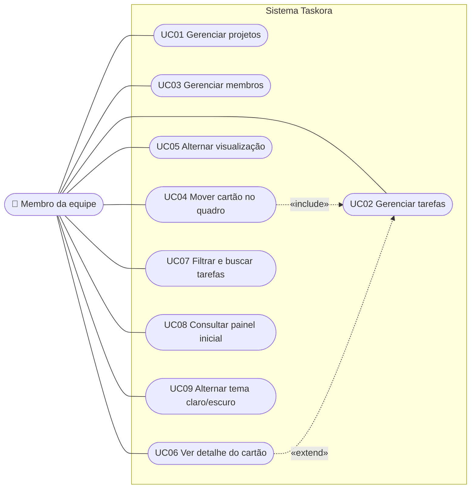

*Figura 1 – Diagrama de casos de uso do Taskora.*

### 7.2. Descrição dos Principais Casos de Uso

**UC01 – Gerenciar projetos**

- **Ator:** Membro da equipe.
- **Fluxo principal:** o usuário clica em "Novo projeto", informa nome, descrição, emoji, capa e prazo e confirma. O sistema valida o nome, grava o projeto e o mostra na barra lateral e na galeria. Na página do projeto, o usuário edita o título, a descrição e o ícone diretamente na tela.
- **Fluxo alternativo:** nome vazio faz a API responder 400 e a interface mostrar a mensagem de erro.
- **Pós-condição:** ao excluir o projeto, suas tarefas também são excluídas (RN07).

**UC02 – Gerenciar tarefas**

- **Ator:** Membro da equipe.
- **Fluxo principal:** o usuário clica em "Novo" ou em "Adicionar cartão" em uma lista, preenche título, projeto, status, prioridade, responsável, data de entrega e etiquetas, e cria o cartão. Depois, pelo detalhe do cartão, altera qualquer campo ou exclui a tarefa.
- **Fluxo alternativo:** título vazio ou status inválido fazem a API responder 400.

**UC04 – Mover cartão no quadro**

- **Ator:** Membro da equipe.
- **Pré-condição:** o projeto está na visualização Quadro.
- **Fluxo principal:** o usuário arrasta um cartão até outra lista. A lista de destino mostra um espaço reservado, e ao soltar o cartão a interface muda o status na hora e envia `PUT /api/tarefas/:id` com o novo status.
- **Fluxo alternativo:** se a API falhar, o cartão volta para a lista original e aparece uma notificação de erro.

**UC06 – Ver detalhe do cartão**

- **Fluxo principal:** ao clicar em um cartão, abre uma janela com capa, título, lista e projeto, responsável, etiquetas, data de entrega, descrição, barra de progresso do checklist e atividade. A coluna lateral tem os botões "Adicionar ao cartão" (membros, etiquetas, checklist, capa) e "Ações" (mover, prioridade, excluir).

**UC08 – Consultar painel inicial**

- **Fluxo principal:** a tela inicial exibe saudação com a data, quatro indicadores (projetos ativos, em andamento, concluídas e atrasadas), gráfico de rosca por status, gráfico de barras por prioridade, progresso de cada projeto, minhas tarefas agrupadas em Hoje, Atrasadas e Próximas, e os prazos dos próximos sete dias.

---

## 8. Arquitetura

### 8.1. Visão em Camadas

O sistema segue uma arquitetura cliente-servidor em camadas. O frontend é uma aplicação de página única (SPA) que consome a API REST. Em produção, o próprio servidor Express entrega os arquivos compilados do frontend (`web/dist`), então tudo roda em uma única porta (4321).

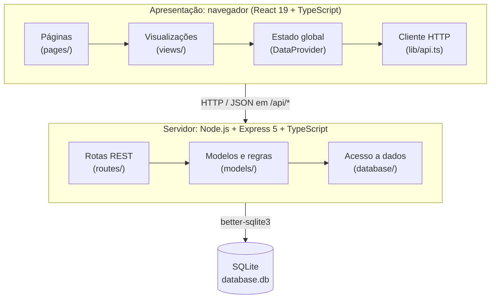

*Figura 2 – Arquitetura em camadas do sistema.*

| Camada | Responsabilidade | Arquivos |
|--------|------------------|----------|
| Apresentação | Telas, componentes, estado da interface e chamadas HTTP | `web/src/` |
| Rotas (controladores) | Receber a requisição, chamar o modelo e devolver o código HTTP e o JSON | `src/routes/` |
| Modelos | Validações e regras de negócio, consultas SQL parametrizadas | `src/models/` |
| Dados | Conexão única com o banco, criação das tabelas e migração das colunas novas | `src/database/` |

### 8.2. Estrutura de Diretórios

```text
tarefas-gestor/
├── src/                      # Backend (TypeScript)
│   ├── server.ts             # App Express, rotas /api e entrega do web/dist
│   ├── seed.ts               # Dados de demonstração
│   ├── database/
│   │   ├── connection.ts     # Conexão única (singleton) com o SQLite
│   │   └── schema.ts         # Tabelas, índices e migração de colunas opcionais
│   ├── models/               # Projeto.ts, Tarefa.ts, Membro.ts
│   ├── routes/               # projetos.ts, tarefas.ts, membros.ts, dashboard.ts
│   └── types/index.ts        # Interfaces compartilhadas
├── test/
│   └── api.test.ts           # 28 testes de integração (Mocha + Chai + Supertest)
├── dist/                     # Backend compilado pelo tsc (npm run build)
├── web/                      # Frontend (React + Vite + TypeScript)
│   ├── src/
│   │   ├── App.tsx           # Rotas da SPA (React Router)
│   │   ├── pages/            # Home, ProjetoPage, Projetos, Tarefas, Membros
│   │   ├── components/       # Sidebar, Topbar, TaskCard, TaskModal, SearchDialog...
│   │   │   ├── views/        # BoardView, TableView, ListView, CalendarView
│   │   │   └── ui/           # button, dialog, dropdown, input (padrão shadcn/ui)
│   │   └── lib/              # api.ts, data.tsx, theme.ts, ui.ts, utils.ts
│   ├── tailwind.config.js
│   └── vite.config.ts        # Proxy /api para localhost:4321 em desenvolvimento
├── docs/                     # GitHub Pages (index.html e screenshots/)
├── documentacao/             # Este documento, PDF e roteiro do vídeo
├── package.json
└── tsconfig.json
```

### 8.3. Padrões Utilizados

- **Arquitetura em camadas:** rotas, modelos e acesso a dados ficam separados.
- **Active Record simplificado:** cada classe de modelo (`ProjetoModel`, `TarefaModel`, `MembroModel`) reúne as operações da sua tabela em métodos estáticos.
- **Singleton:** `getDatabase()` cria uma única conexão com o banco e a reutiliza.
- **REST:** recursos identificados por URL e manipulados pelos verbos GET, POST, PUT e DELETE (FIELDING, 2000).
- **Provider (React Context):** `DataProvider` centraliza projetos, tarefas e membros e expõe funções de atualização para todas as telas.
- **Atualização otimista:** a interface aplica a mudança antes da resposta da API e desfaz se houver erro.
- **Componentes reutilizáveis:** os componentes de `components/ui` seguem o padrão do shadcn/ui, montados sobre primitivas acessíveis do Radix UI.

---

## 9. Tecnologias Utilizadas

### 9.1. Backend

| Tecnologia | Uso |
|------------|-----|
| Node.js | Ambiente de execução JavaScript no servidor |
| TypeScript 7 | Tipagem estática do backend, compilado com `tsc` para `dist/` |
| Express 5 | Framework web para a API REST e entrega dos arquivos do frontend |
| better-sqlite3 | Driver síncrono e rápido para o banco SQLite |
| SQLite | Banco de dados relacional em arquivo (`database.db`) |
| cors | Liberação de requisições entre origens no desenvolvimento |
| tsx | Execução direta de TypeScript (`npm run dev`, `npm run seed` e testes) |

### 9.2. Frontend

| Tecnologia | Uso |
|------------|-----|
| React 19 | Biblioteca de interface baseada em componentes |
| TypeScript | Tipagem estática do frontend |
| Vite 8 | Servidor de desenvolvimento e build de produção |
| React Router 7 | Navegação entre páginas da SPA |
| Tailwind CSS 3 | Estilização por classes utilitárias, com modo escuro por classe |
| shadcn/ui + Radix UI | Componentes acessíveis de botão, diálogo, menu e campos |
| lucide-react | Biblioteca de ícones |
| recharts | Gráficos de rosca e de barras do painel inicial |
| @dnd-kit | Arrastar e soltar dos cartões no quadro Kanban |
| sonner | Notificações (toast) de sucesso e erro |
| date-fns | Formatação de datas em português e cálculo de prazos |
| Inter (Fontsource) | Tipografia da interface |

### 9.3. Testes e Ferramentas

| Ferramenta | Uso |
|------------|-----|
| Mocha | Executor de testes, rodando TypeScript via `tsx` |
| Chai | Asserções (`expect`) |
| Supertest | Requisições HTTP à API dentro dos testes |
| oxlint | Análise estática do código do frontend |
| Git e GitHub | Controle de versão e hospedagem do repositório |
| GitHub Pages | Página de apresentação do projeto (`docs/`) |

### 9.4. Justificativa das Escolhas

O **TypeScript** nas duas pontas permite descrever as entidades com interfaces (`Projeto`, `Tarefa`, `Membro`) e detectar erros na compilação. O **SQLite** dispensa a instalação de um servidor de banco, o que facilita a correção e a execução do projeto em qualquer computador, sem abrir mão de chaves estrangeiras, restrições CHECK e índices. O **React** com **Tailwind** e **shadcn/ui** permitiu construir uma interface próxima à de ferramentas profissionais com componentes acessíveis e prontos para personalizar, e o **@dnd-kit** oferece arrastar e soltar com suporte a mouse, toque e teclado.

---

## 10. Modelagem de Dados

### 10.1. Diagrama de Classes

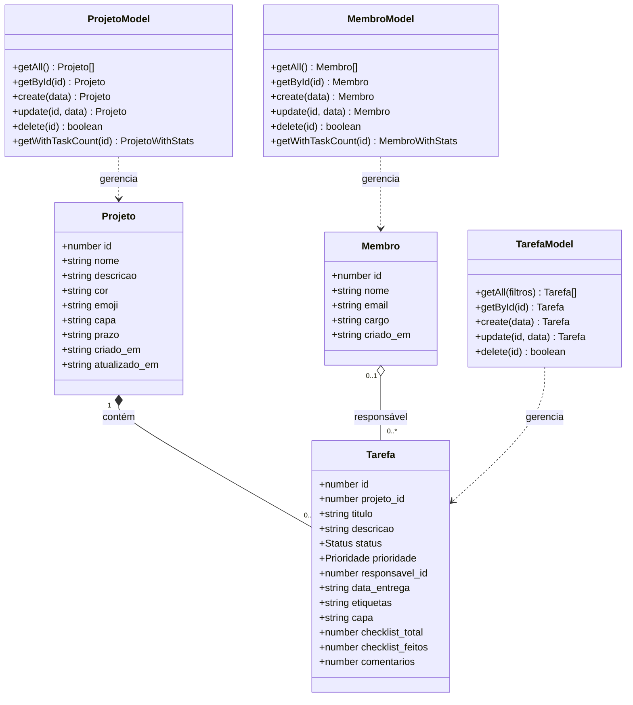

*Figura 3 – Diagrama de classes das entidades e dos modelos.*

`Status` aceita "A fazer", "Em andamento" e "Concluído". `Prioridade` aceita "Baixa", "Média" e "Alta".

### 10.2. Modelo Entidade-Relacionamento

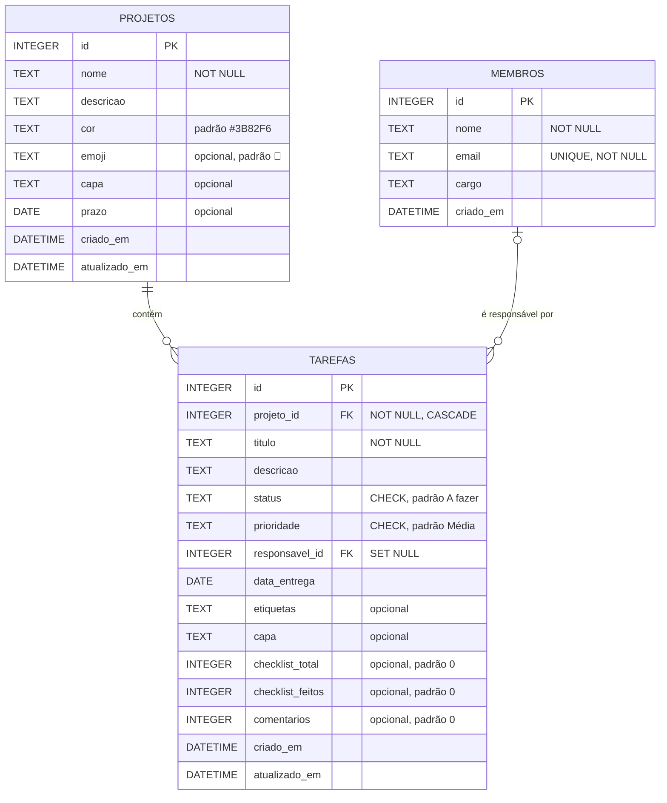

*Figura 4 – Modelo entidade-relacionamento, com as colunas opcionais da segunda versão.*

### 10.3. Dicionário de Dados

**Tabela `projetos`**

| Coluna | Tipo | Restrição | Descrição |
|--------|------|-----------|-----------|
| id | INTEGER | PK, AUTOINCREMENT | Identificador |
| nome | TEXT | NOT NULL | Nome do projeto |
| descricao | TEXT | | Descrição |
| cor | TEXT | DEFAULT '#3B82F6' | Cor de destaque |
| emoji | TEXT | DEFAULT '📁' (opcional) | Ícone da página |
| capa | TEXT | opcional | Chave da capa em degradê (ex.: aurora, oceano) |
| prazo | DATE | opcional | Prazo final do projeto |
| criado_em / atualizado_em | DATETIME | DEFAULT CURRENT_TIMESTAMP | Datas de controle |

**Tabela `tarefas`**

| Coluna | Tipo | Restrição | Descrição |
|--------|------|-----------|-----------|
| id | INTEGER | PK, AUTOINCREMENT | Identificador |
| projeto_id | INTEGER | FK projetos(id), NOT NULL, ON DELETE CASCADE | Projeto da tarefa |
| titulo | TEXT | NOT NULL | Título do cartão |
| descricao | TEXT | | Descrição detalhada |
| status | TEXT | CHECK (A fazer, Em andamento, Concluído) | Lista do quadro |
| prioridade | TEXT | CHECK (Baixa, Média, Alta) | Prioridade |
| responsavel_id | INTEGER | FK membros(id), ON DELETE SET NULL | Responsável |
| data_entrega | DATE | | Data de entrega |
| etiquetas | TEXT | DEFAULT '' (opcional) | Etiquetas separadas por vírgula |
| capa | TEXT | opcional | Cor da capa do cartão |
| checklist_total | INTEGER | DEFAULT 0 (opcional) | Itens do checklist |
| checklist_feitos | INTEGER | DEFAULT 0 (opcional) | Itens concluídos |
| comentarios | INTEGER | DEFAULT 0 (opcional) | Contador de comentários |
| criado_em / atualizado_em | DATETIME | DEFAULT CURRENT_TIMESTAMP | Datas de controle |

**Tabela `membros`**

| Coluna | Tipo | Restrição | Descrição |
|--------|------|-----------|-----------|
| id | INTEGER | PK, AUTOINCREMENT | Identificador |
| nome | TEXT | NOT NULL | Nome completo |
| email | TEXT | UNIQUE, NOT NULL | E-mail |
| cargo | TEXT | | Cargo na equipe |
| criado_em | DATETIME | DEFAULT CURRENT_TIMESTAMP | Data de cadastro |

Os índices `idx_tarefas_projeto`, `idx_tarefas_status` e `idx_tarefas_responsavel` aceleram os filtros mais usados. As colunas marcadas como opcionais foram criadas na segunda versão do sistema. A função `migrateOptionalColumns` em `schema.ts` verifica as colunas existentes com `PRAGMA table_info` e adiciona as que faltam com `ALTER TABLE`, então um banco da primeira versão continua funcionando.

---

## 11. Diagrama de Sequência: Mover um Cartão

O diagrama mostra o que acontece quando o usuário arrasta um cartão da lista "A fazer" para "Em andamento".

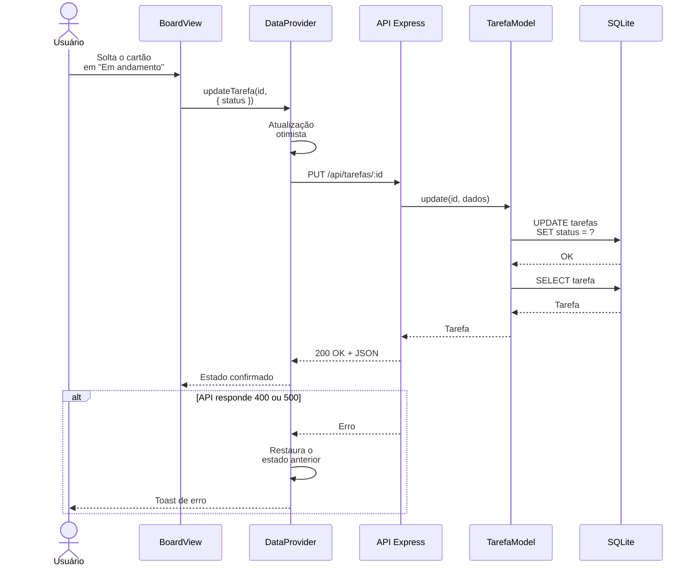

*Figura 5 – Diagrama de sequência ao mover um cartão no quadro.*

---

## 12. API REST

Todas as rotas usam o prefixo `/api`, recebem e devolvem JSON.

| Método | Rota | Descrição | Respostas |
|--------|------|-----------|-----------|
| GET | `/api/dashboard` | Totais de projetos, membros e tarefas, tarefas por status, atrasadas e por prioridade | 200 |
| GET | `/api/projetos` | Lista os projetos (mais recentes primeiro) | 200 |
| GET | `/api/projetos/:id` | Busca um projeto com estatísticas das tarefas | 200, 404 |
| POST | `/api/projetos` | Cria um projeto | 201, 400 |
| PUT | `/api/projetos/:id` | Atualiza um projeto | 200, 400, 404 |
| DELETE | `/api/projetos/:id` | Exclui o projeto e suas tarefas | 204, 404 |
| GET | `/api/tarefas` | Lista tarefas, com filtros opcionais `projeto_id`, `responsavel_id`, `status` e `prioridade` | 200 |
| GET | `/api/tarefas/atrasadas/lista` | Lista as tarefas atrasadas, ordenadas por data de entrega | 200 |
| GET | `/api/tarefas/:id` | Busca uma tarefa com nome do projeto e do responsável | 200, 404 |
| POST | `/api/tarefas` | Cria uma tarefa | 201, 400 |
| PUT | `/api/tarefas/:id` | Atualiza só os campos enviados (atualização parcial) | 200, 400, 404 |
| DELETE | `/api/tarefas/:id` | Exclui uma tarefa | 204, 404 |
| GET | `/api/membros` | Lista os membros em ordem alfabética | 200 |
| GET | `/api/membros/:id` | Busca um membro com estatísticas das tarefas | 200, 404 |
| POST | `/api/membros` | Cria um membro | 201, 400 |
| PUT | `/api/membros/:id` | Atualiza um membro | 200, 400, 404 |
| DELETE | `/api/membros/:id` | Exclui um membro (as tarefas ficam sem responsável) | 204, 404 |

Exemplo de criação de tarefa:

```http
POST /api/tarefas
Content-Type: application/json

{
  "projeto_id": 1,
  "titulo": "API de matrículas e disciplinas",
  "status": "Em andamento",
  "prioridade": "Alta",
  "responsavel_id": 3,
  "data_entrega": "2026-11-17",
  "etiquetas": ["backend", "api"],
  "checklist_total": 6,
  "checklist_feitos": 3
}
```

---

## 13. Interface e Telas

As capturas abaixo foram feitas com os dados de demonstração criados pelo comando `npm run seed`.

### 13.1. Início (painel)

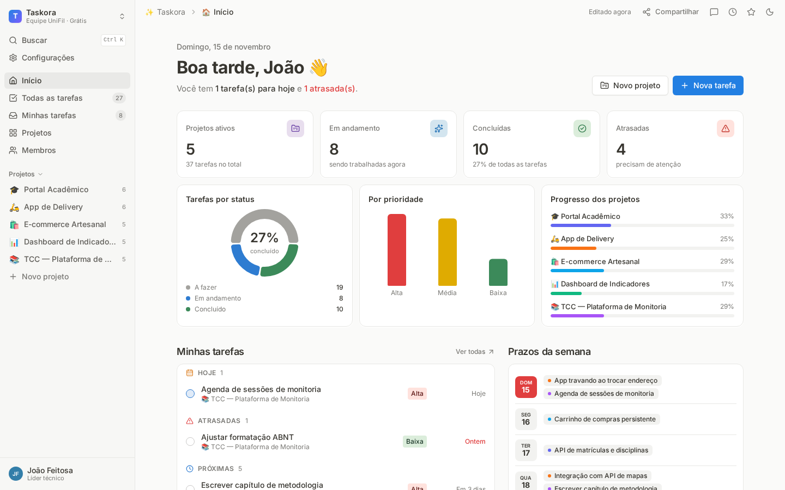

*Figura 6 – Tela inicial: indicadores, gráfico de tarefas por status, gráfico por prioridade, progresso dos projetos, minhas tarefas e prazos da semana.*

### 13.2. Página do Projeto: Quadro Kanban

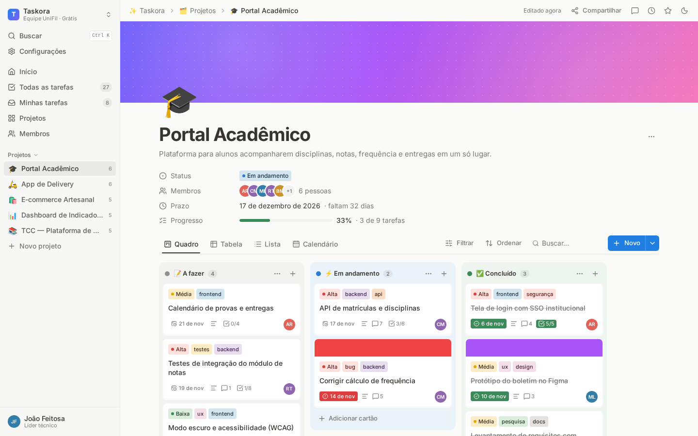

*Figura 7 – Página do projeto no estilo Notion (capa, emoji, status, membros, prazo e progresso) com o quadro Kanban no estilo Trello.*

### 13.3. Arrastando um Cartão

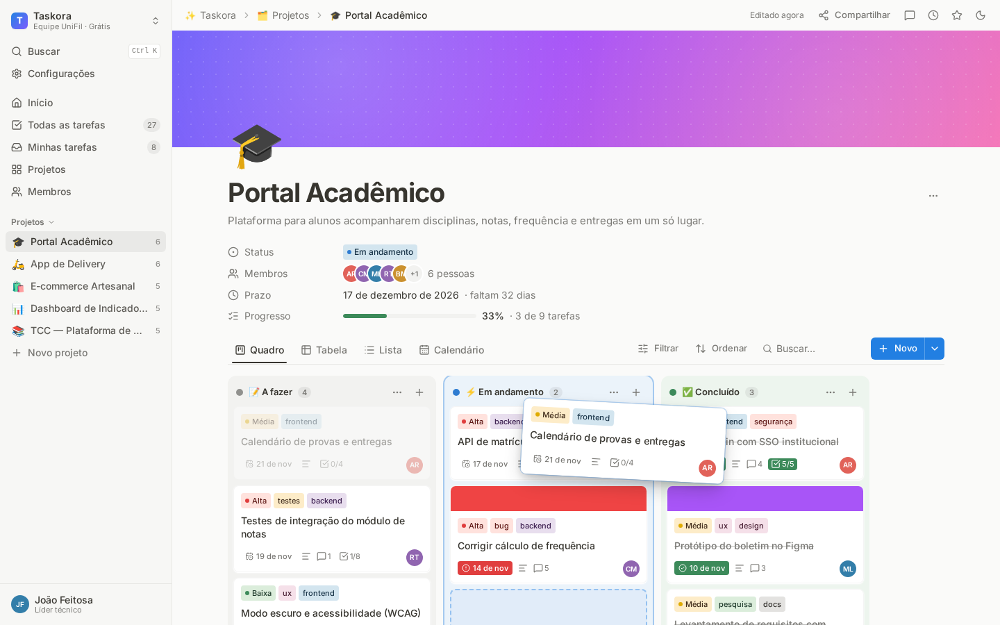

*Figura 8 – Cartão sendo arrastado para outra lista, com espaço reservado no destino.*

### 13.4. Detalhe do Cartão

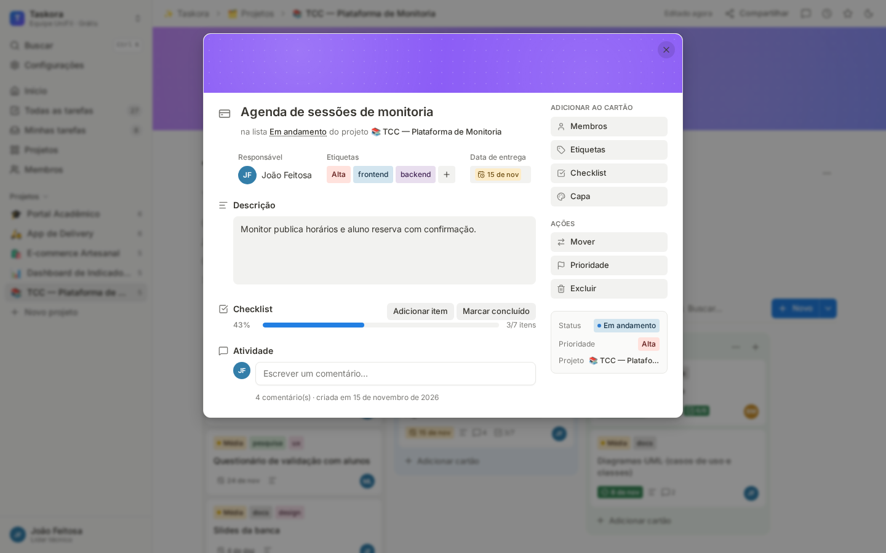

*Figura 9 – Detalhe do cartão com responsável, etiquetas, data de entrega, descrição, checklist, atividade e ações.*

### 13.5. Visualização em Tabela

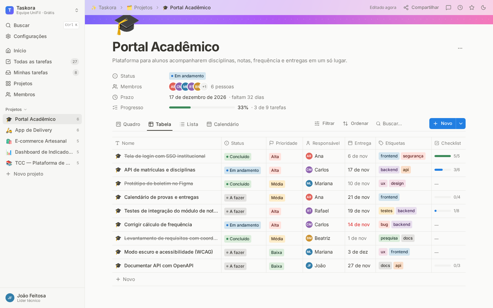

*Figura 10 – Visualização em tabela com status, prioridade, responsável, etiquetas, entrega e checklist.*

### 13.6. Visualização em Calendário

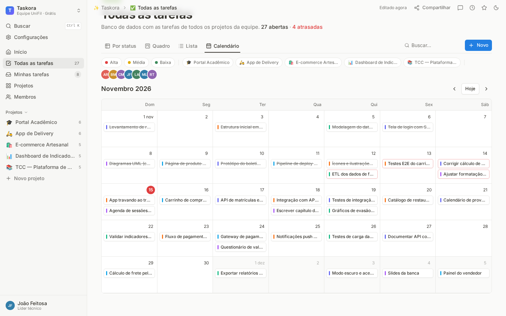

*Figura 11 – Calendário mensal com as tarefas posicionadas pela data de entrega.*

### 13.7. Modo Escuro

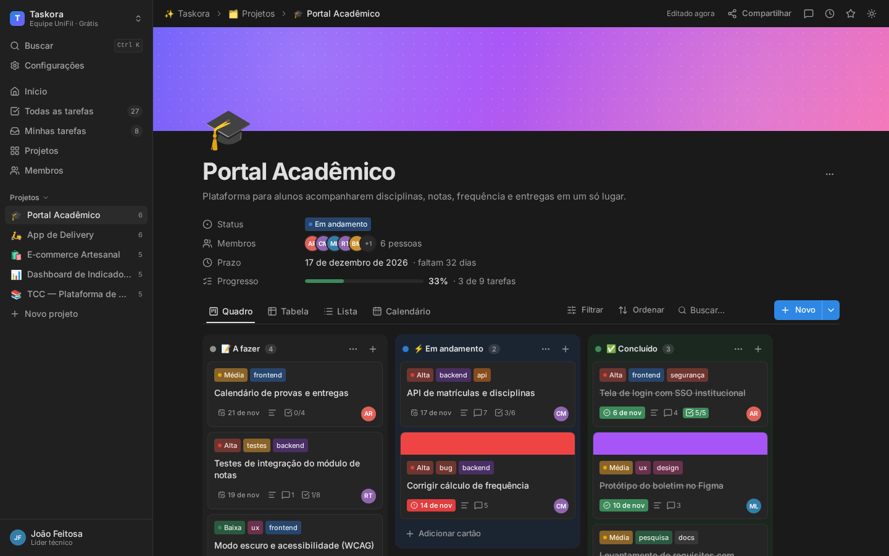

*Figura 12 – O mesmo quadro no modo escuro.*

Outras capturas (todas as tarefas, membros e início no modo escuro) estão na pasta `docs/screenshots/` do repositório.

---

## 14. Plano de Testes

### 14.1. Estratégia

Foram implementados **testes de integração** da API com Mocha, Chai e Supertest, escritos em TypeScript e executados pelo `tsx`. Cada teste faz uma requisição HTTP real ao aplicativo Express e verifica o código de resposta e o conteúdo JSON. Os testes usam um banco separado (`database-test.db`, definido pela variável `DATABASE_PATH`) e a variável `NODE_ENV=test`, que impede o servidor de abrir a porta. Assim o banco principal nunca é alterado.

O frontend foi validado com testes manuais exploratórios de cada tela (criação, edição, exclusão, arrastar e soltar, filtros, busca e tema), além da verificação de tipos do TypeScript no build (`tsc -b`).

### 14.2. Casos de Teste Implementados (28)

| Nº | Grupo | Caso de teste | Resultado esperado |
|----|-------|---------------|--------------------|
| 1 | Projetos | POST /api/projetos cria um novo projeto | 201 com id |
| 2 | Projetos | POST /api/projetos com nome vazio | 400 |
| 3 | Projetos | GET /api/projetos lista todos os projetos | 200 com lista |
| 4 | Projetos | GET /api/projetos/:id retorna um projeto | 200 |
| 5 | Projetos | PUT /api/projetos/:id atualiza um projeto | 200 com dados novos |
| 6 | Projetos | DELETE /api/projetos/:id exclui um projeto | 204 |
| 7 | Membros | POST /api/membros cria um novo membro | 201 |
| 8 | Membros | POST /api/membros com e-mail inválido | 400 |
| 9 | Membros | POST /api/membros com e-mail duplicado | 400 |
| 10 | Membros | GET /api/membros lista todos os membros | 200 |
| 11 | Membros | GET /api/membros/:id retorna um membro | 200 |
| 12 | Membros | PUT /api/membros/:id atualiza um membro | 200 |
| 13 | Tarefas | POST /api/tarefas cria uma nova tarefa | 201 |
| 14 | Tarefas | POST /api/tarefas com título vazio | 400 |
| 15 | Tarefas | POST /api/tarefas com status inválido | 400 |
| 16 | Tarefas | GET /api/tarefas lista todas as tarefas | 200 |
| 17 | Tarefas | GET /api/tarefas?projeto_id filtra por projeto | 200, só o projeto pedido |
| 18 | Tarefas | GET /api/tarefas?prioridade filtra por prioridade | 200, só a prioridade pedida |
| 19 | Tarefas | GET /api/tarefas/:id retorna uma tarefa | 200 |
| 20 | Tarefas | PUT /api/tarefas/:id atualiza uma tarefa | 200 |
| 21 | Tarefas | GET /api/tarefas/atrasadas/lista retorna as atrasadas | 200 |
| 22 | Tarefas | DELETE /api/tarefas/:id exclui uma tarefa | 204 |
| 23 | Campos opcionais | POST /api/projetos sem campos opcionais usa os valores padrão | 201, emoji 📁 |
| 24 | Campos opcionais | POST /api/projetos salva emoji, capa e prazo | 201 com os valores |
| 25 | Campos opcionais | PUT /api/projetos/:id mantém emoji e capa quando não enviados | 200, valores mantidos |
| 26 | Campos opcionais | POST /api/tarefas normaliza etiquetas e salva o checklist | 201, etiquetas sem repetição |
| 27 | Campos opcionais | PUT /api/tarefas/:id atualiza etiquetas sem alterar outros campos | 200 |
| 28 | Dashboard | GET /api/dashboard retorna as estatísticas gerais | 200 com totais |

### 14.3. Execução

```bash
npm test
```

Resultado obtido: **28 testes passando** (`28 passing`). As mensagens de erro que aparecem no console durante a execução são esperadas, porque vêm dos testes que enviam dados inválidos de propósito.

---

## 15. Análise de Falhas e Riscos (FMEA)

| Modo de falha | Efeito | S | Causa | O | D | RPN | Ação preventiva |
|---------------|--------|---|-------|---|---|-----|-----------------|
| Status inválido gravado | Cartão some do quadro | 6 | Dados enviados direto à API | 3 | 2 | 36 | CHECK no banco e teste nº 15 |
| E-mail duplicado ou inválido | Cadastro inconsistente | 5 | Falta de validação | 3 | 2 | 30 | UNIQUE, regex no modelo e testes nº 8 e 9 |
| Tarefa órfã | Dado sem projeto | 7 | Exclusão de projeto | 2 | 3 | 42 | Chave estrangeira com ON DELETE CASCADE |
| Banco antigo sem colunas novas | Erro ao abrir o sistema | 8 | Atualização de versão | 4 | 3 | 96 | Migração automática em `migrateOptionalColumns` |
| Falha ao mover cartão | Quadro diferente do banco | 6 | Erro de rede ou da API | 3 | 4 | 72 | Atualização otimista com restauração e toast de erro |
| Cartão solto fora de uma lista | Movimento perdido | 3 | Precisão do mouse | 5 | 3 | 45 | Detecção de colisão por ponteiro e por retângulo |
| Etiquetas repetidas ou vazias | Visual poluído | 3 | Entrada livre do usuário | 6 | 2 | 36 | Normalização em `normalizeEtiquetas` e teste nº 26 |
| Perda do arquivo do banco | Perda de dados | 9 | Exclusão acidental | 2 | 7 | 126 | Backup do `database.db` e `npm run seed` para recriar a demonstração |
| Testes alterando dados reais | Perda dos dados de demonstração | 7 | Mesmo banco nos testes | 2 | 5 | 70 | Banco separado `database-test.db` via `DATABASE_PATH` |
| Uso sem autenticação | Qualquer pessoa altera dados | 7 | Fora do escopo | 5 | 4 | 140 | Uso local e autenticação prevista como trabalho futuro |
| Erro de tipo entre front e back | Campo exibido errado | 5 | Contratos diferentes | 3 | 3 | 45 | Interfaces TypeScript nos dois lados e build com `tsc` |

**Legenda:** S = severidade, O = ocorrência, D = detecção (1 a 10). RPN = S × O × D.

**Riscos prioritários (RPN acima de 100):**

1. **Uso sem autenticação (140):** aceito nesta versão, porque o sistema é de uso local. A autenticação é o primeiro item dos trabalhos futuros.
2. **Perda do arquivo do banco (126):** mitigada com cópias de segurança do `database.db` e com o script de seed, que recria a base de demonstração.

---

## 16. Como Executar

**Pré-requisitos:** Node.js 20 ou superior, npm e Git.

```bash
# 1. Clonar o repositório
git clone https://github.com/joaogpnfs/tarefas-gestor.git
cd tarefas-gestor

# 2. Instalar as dependências do backend e do frontend
npm install
cd web && npm install && cd ..

# 3. Compilar o backend e o frontend
npm run build
cd web && npm run build && cd ..

# 4. Criar o banco com os dados de demonstração
npm run seed

# 5. Iniciar o servidor
npm start
```

Depois é só abrir **http://localhost:4321** no navegador.

Outros comandos:

| Comando | Função |
|---------|--------|
| `npm test` | Executa os 28 testes de integração |
| `npm run dev` | Inicia o backend direto do TypeScript |
| `cd web && npm run dev` | Inicia o frontend em modo de desenvolvimento (Vite), com proxy para a API |

**Links do projeto:**

- Repositório: https://github.com/joaogpnfs/tarefas-gestor
- Página do projeto (GitHub Pages): https://joaogpnfs.github.io/tarefas-gestor/

---

## 17. Cronograma

| Fase | Atividades | Status |
|------|------------|--------|
| 1. Planejamento | Tema, requisitos, regras de negócio e casos de uso | Concluído |
| 2. Modelagem | Diagrama de classes, modelo ER e arquitetura | Concluído |
| 3. Backend | Banco SQLite, modelos, rotas e testes da API | Concluído |
| 4. Primeira interface | Versão inicial em JavaScript puro (tag `v1.0-vanilla`) | Concluído |
| 5. Migração para TypeScript | Backend e testes em TypeScript, frontend em React | Concluído |
| 6. Nova interface | Inspiração Notion e Trello, quatro visualizações, detalhe do cartão | Concluído |
| 7. Documentação | Documento técnico, README, página do projeto e roteiro | Concluído |
| 8. Defesa | Gravação e entrega do vídeo de defesa | Planejado |

---

## 18. Conclusão

O Taskora atende aos requisitos das disciplinas: tem tema livre bem definido, banco de dados relacional, CRUD completo das três entidades, documentação com modelagem e testes automatizados, e está versionado no GitHub. Além do mínimo pedido, o sistema oferece quatro formas de ver as tarefas, arrastar e soltar no quadro, painel com gráficos e modo escuro.

O projeto passou por uma evolução que também foi uma lição de engenharia de software. A primeira versão, em JavaScript puro, foi preservada na tag `v1.0-vanilla`, e a migração para TypeScript e React foi feita mantendo os testes da API passando a cada etapa. Isso mostrou na prática o valor dos testes automatizados como rede de segurança em uma refatoração grande, e o valor da tipagem para manter frontend e backend falando a mesma língua.

### Trabalhos Futuros

- Autenticação de usuários e permissões por projeto.
- Comentários com texto, anexos e itens de checklist individuais.
- Ordenação manual dos cartões dentro da mesma lista.
- Notificações de prazos próximos.
- Histórico de alterações das tarefas.
- Hospedagem em nuvem com banco de dados gerenciado.

---

## Referências

ANDERSON, David J. **Kanban: successful evolutionary change for your technology business**. Sequim: Blue Hole Press, 2010.

ASSOCIAÇÃO BRASILEIRA DE NORMAS TÉCNICAS. **NBR 14724**: informação e documentação: trabalhos acadêmicos: apresentação. Rio de Janeiro: ABNT, 2011.

DND KIT. **Documentation**. Disponível em: https://docs.dndkit.com/. Acesso em: 15 nov. 2026.

EXPRESS. **Express: fast, unopinionated, minimalist web framework for Node.js**. Disponível em: https://expressjs.com/. Acesso em: 15 nov. 2026.

FIELDING, Roy Thomas. **Architectural styles and the design of network-based software architectures**. 2000. Tese (Doutorado em Ciência da Computação) – University of California, Irvine, 2000.

MICROSOFT. **TypeScript documentation**. Disponível em: https://www.typescriptlang.org/docs/. Acesso em: 15 nov. 2026.

PRESSMAN, Roger S.; MAXIM, Bruce R. **Engenharia de software: uma abordagem profissional**. 8. ed. Porto Alegre: AMGH, 2016.

REACT. **React documentation**. Disponível em: https://react.dev/. Acesso em: 15 nov. 2026.

SHADCN. **shadcn/ui**. Disponível em: https://ui.shadcn.com/. Acesso em: 15 nov. 2026.

SOMMERVILLE, Ian. **Engenharia de software**. 10. ed. São Paulo: Pearson, 2018.

SQLITE. **SQLite documentation**. Disponível em: https://www.sqlite.org/docs.html. Acesso em: 15 nov. 2026.

TAILWIND LABS. **Tailwind CSS documentation**. Disponível em: https://tailwindcss.com/docs. Acesso em: 15 nov. 2026.

VITE. **Vite: guide**. Disponível em: https://vite.dev/guide/. Acesso em: 15 nov. 2026.
